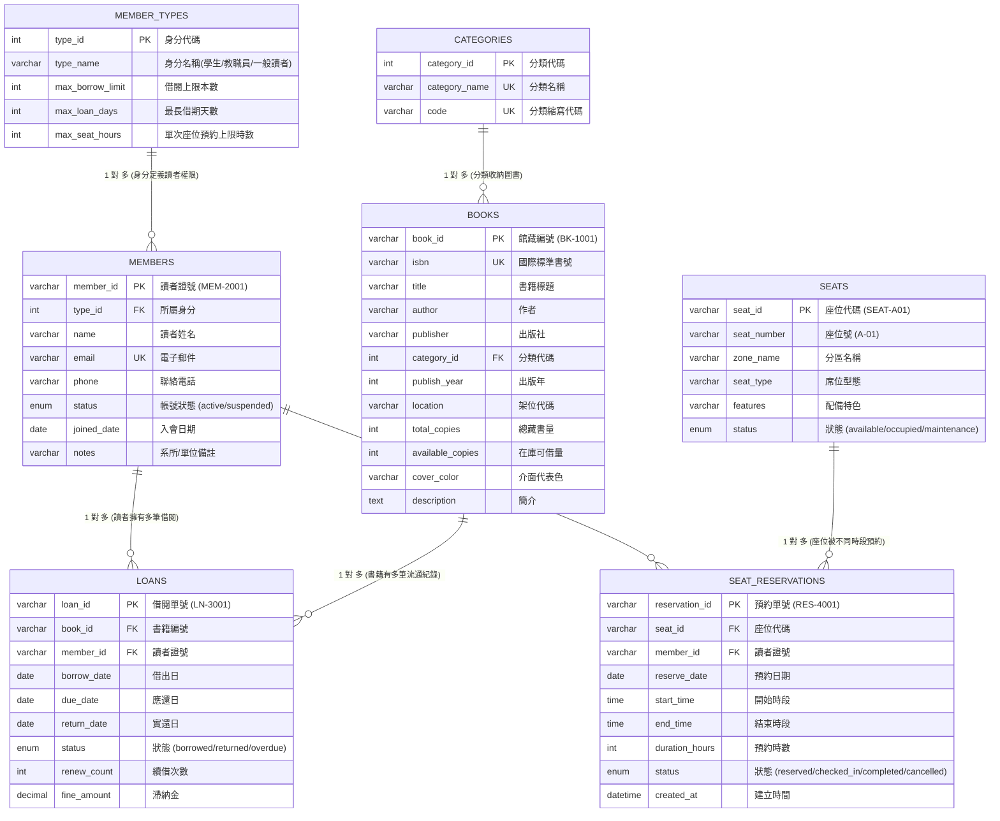

# 智慧圖書館與自習室預約系統 - MySQL 資料庫規格書

本系統採用 **MySQL 8.0+**，字元編碼為 `utf8mb4`，排序規則為 `utf8mb4_unicode_ci`。
經過**第三正規化（3NF）**設計，涵蓋 **7 張核心資料表**，完整支援圖書館藏書流通、讀者借閱權限管理與自習座位預約時段防撞。

---

## 📊 1. ER 實體關聯圖 (Entity-Relationship Diagram)



---

## 📁 2. SQL 檔案架構

- **`schema.sql`**：建庫、建表（7 張 Table）、外鍵約束、欄位限制（CHECK）、高頻查詢索引（INDEX）。
- **`seed.sql`**：系統初始資料，包含原本現有系統中的 8 本精選書籍、5 位讀者、8 筆流通紀錄、12 個多功能席位、6 筆座位預約。
- **`setup_all.sql`**：**一鍵安裝完整腳本**（整合建表 + 範例資料）。
- **`queries.sql`**：6 大核心業務進階 SQL 查詢（多表 JOIN、GROUP BY 統計、排行、滯納金計算報表）。

---

## 🚀 3. 如何在 MySQL 中匯入

### 方法一：使用命令列（Command Line）
```bash
mysql -u root -p < database/setup_all.sql
```

### 方法二：使用 GUI 工具（MySQL Workbench / phpMyAdmin / HeidiSQL）
1. 打開你的 MySQL 管理工具連線至資料庫。
2. 開啟 **`database/setup_all.sql`** 檔案。
3. 點擊 **Execute (全文執行)**。
4. 重新整理資料庫列表，即可看見 **`smart_library`** 資料庫與 7 張完整的資料表及資料。

---

## 🔍 4. 業務驗證與進階查詢 (摘錄自 queries.sql)

1. **借閱中與逾期未還清單（多表關聯 JOIN）**：
   - 串接 `loans` + `books` + `members` + `member_types`，即時呈現催繳對象。
2. **各類別藏書量與流通借出率分析（GROUP BY 聚合統計）**：
   - 計算各分類庫存與流通比例，直接對應系統 Dashboard 圖表。
3. **自習室預約時段衝突檢核（防重複預約）**：
   - 透過 `seat_id`、`reserve_date` 與時段範圍 `start_time` / `end_time` 檢核防撞。
